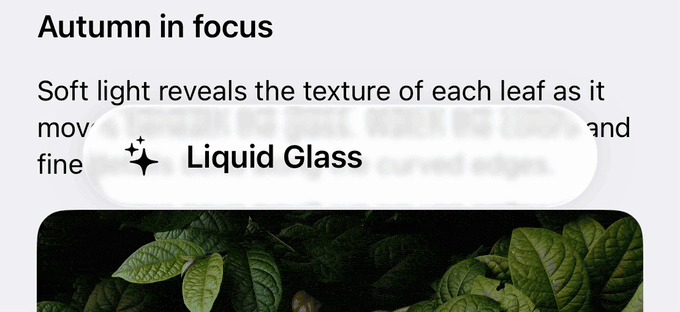

# Glass Background



`GlassBackgroundView` is a custom Liquid Glass effect implementation: live backdrop blur, refracted edges, tint, and interactive highlights. `GlassBackgroundContainerView` groups multiple glass surfaces.

The implementation is extracted and adapted from [Telegram iOS](https://github.com/TelegramMessenger/Telegram-iOS). The package supports iOS 13+; by default it uses system glass on iOS 26+ and the custom renderer on earlier versions. The preview above shows custom glass.

## API

- `GlassBackgroundView.init(frame: CGRect)` creates a glass surface.
- `GlassBackgroundView.contentView: UIView` hosts foreground labels, icons, and controls. `GlassBackgroundView.maskContentView: UIView` hosts custom tint masks; `GlassBackgroundView.transitionView: UIView` exposes the surface to animate.
- `GlassBackgroundView.update(size: CGSize, cornerRadius: CGFloat, isDark: Bool, tintColor: GlassBackgroundView.TintColor, isInteractive: Bool = false, isVisible: Bool = true)` configures and lays out the surface. `isInteractive` enables touch feedback when hosted content receives touches. `isVisible` hides only the material; hide the outer view to hide everything.
- `GlassBackgroundView.update(size: CGSize, cornerRadii: GlassBackgroundView.CornerRadii, isDark: Bool, tintColor: GlassBackgroundView.TintColor, isInteractive: Bool = false, isVisible: Bool = true)` accepts independent corner radii.
- `GlassBackgroundView.CornerRadii.init(topLeft: CGFloat, topRight: CGFloat, bottomLeft: CGFloat, bottomRight: CGFloat)` specifies each corner; `GlassBackgroundView.CornerRadii.init(radius: CGFloat)` sets all four equally.
- `GlassBackgroundView.TintColor.init(kind: GlassBackgroundView.TintColor.Kind, innerColor: UIColor? = nil, innerInset: CGFloat = 3.0)` configures tint and an optional inset fill. `GlassBackgroundView.TintColor.Kind` has `.panel`, `.clear`, and `.custom(style: GlassBackgroundView.TintColor.CustomStyle, color: UIColor)` cases; `GlassBackgroundView.TintColor.CustomStyle` has `.default` and `.clear` cases.
- `GlassBackgroundView.params: GlassBackgroundView.Params?` is read-only and contains the last applied `shape`, `isDark`, `tintColor`, `isInteractive`, and `isVisible` values.
- `GlassBackgroundView.useCustomGlassImpl: Bool` is a mutable static flag, defaulting to `false`, that selects the implementation at initialization.
- `GlassBackgroundContainerView.init(spacing: CGFloat = 7.0)` creates a group. Add surfaces to `GlassBackgroundContainerView.contentView: UIView`.
- `GlassBackgroundContainerView.update(size: CGSize, isDark: Bool)` lays out the container. Give each child its own frame and `update` call.

## Setup

Add the `GlassBackground` package product and import it. Dependencies are included; no Metal engine setup is needed.

To force the custom implementation, temporarily set `useCustomGlassImpl` on the main thread before constructing surfaces and containers:

```swift
let previous = GlassBackgroundView.useCustomGlassImpl
GlassBackgroundView.useCustomGlassImpl = true
let glass = GlassBackgroundView(frame: .zero)
GlassBackgroundView.useCustomGlassImpl = previous
```

This global flag is read during initialization. Changing it does not update existing views; recreate the complete group to switch implementations.

## Usage

1. Add the glass above the content it should sample, such as a scroll view.
2. Add foreground views to `glass.contentView`. Keep references to both the glass and its hosted views.
3. Set the outer frame, call `update`, and lay out foreground content separately. Repeat when bounds or system appearance changes, typically in `viewDidLayoutSubviews()`.

```swift
import GlassBackground
import UIKit

// Setup once in a view controller.
let glass = GlassBackgroundView(frame: .zero)
let button = UIButton(type: .system)
button.setTitle("Continue", for: .normal)
glass.contentView.addSubview(button)
view.addSubview(glass)

// During layout; wire button actions as usual.
glass.frame = CGRect(x: 24, y: 120, width: 240, height: 56)
glass.update(
    size: glass.bounds.size, cornerRadius: 28,
    isDark: traitCollection.userInterfaceStyle == .dark,
    tintColor: .init(kind: .panel), isInteractive: true
)
button.frame = glass.bounds
```

A complete SwiftUI/UIKit playground with grouped surfaces, press/drag feedback, tint choices, and implementation switching is available in [`Examples/TelegramHighlights/Views/GlassBackgroundView.swift`](../../Examples/TelegramHighlights/Views/GlassBackgroundView.swift).

## How It Works

1. **Sample the live backdrop.** The custom renderer creates a `CABackdropLayer` behind foreground content. A Gaussian filter softens it; the normal style adds a color matrix to intensify colors. Rounded clipping defines the silhouette.

2. **Build a lens-shaped sampling map.** On iOS 17+ with a supported device capability, `generateGlassMesh` divides the surface into a center patch, edge strips, and rounded corner wedges. A signed-distance function measures distance to the rounded boundary; its gradient gives the edge normal. Displacement points inward, follows a cubic Bézier falloff toward the interior, and receives an extra boost near the silhouette.

3. **Warp background samples.** Each mesh vertex pairs a source coordinate (`from`) with a destination (`to`). Offsetting the source while retaining the destination geometry bends backdrop samples around the perimeter, leaving the center largely undistorted. Offsets are normalized by width and height; the current lens uses a 20-point displacement parameter and an edge band up to 12 points wide. The mesh becomes a private Core Animation mesh transform on the backdrop layer. Foreground content remains in a separate, unwarped hierarchy.

4. **Composite the finish.** Generated stretchable images supply tint, rim lighting, and shadow. Optional content masks control the tint overlay. Cached mesh templates are instantiated for the current size, and the compositor samples moving content without an app-managed snapshot loop.

5. **Respond to touch.** Interactive custom surfaces add a touch-following radial highlight, spring-driven enlargement, and directional stretch; release or cancellation restores their shape. System glass delegates feedback to `UIGlassEffect.isInteractive`.

See [`GenerateMesh.swift`](../MeshTransform/GenerateMesh.swift) and Bartosz Ciechanowski's [Mesh Transforms](https://ciechanow.ski/mesh-transforms/) for the mapping technique.

On iOS 26+, the native container uses `UIGlassContainerEffect`, with `spacing` controlling when nearby surfaces merge. The custom container provides grouping and touch routing; each child handles its own feedback.

The custom path depends on private backdrop, filter, and mesh runtime APIs, so test it on your target OS versions and devices. Earlier or less capable systems retain the backdrop treatment without mesh refraction; the system path uses UIKit's glass renderer instead.
